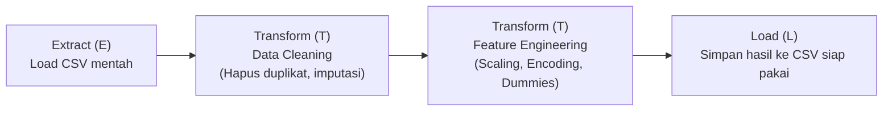

# Dokumentasi Data Pipeline

Pipeline ini mencakup tahapan **Load Data**, **Data Inspection**, **Data Cleaning**, **Data Transformation**, hingga menghasilkan **Processed Dataset** (`automobile_processed_v2.csv`).

---

## 1. Deskripsi Singkat Dataset
Dataset ini berisi data spesifikasi, karakteristik, dan estimasi harga dari berbagai merk mobil. Atribut di dalamnya meliputi dimensi kendaraan (*wheel-base*, *length*, *width*, *height*, *curb-weight*), spesifikasi mesin (*engine-type*, *num-of-cylinders*, *engine-size*, *fuel-system*, *bore*, *stroke*, *compression-ratio*, *horsepower*, *peak-rpm*), efisiensi bahan bakar (*city-mpg*, *highway-mpg*, *city-L/100km*), dan indikator tingkat risiko asuransi (*symboling*).


## 2. Sumber Dataset
Dataset ini didapatkan dari Tugas Rework Assigntment 1.

## 3. Struktur Folder Project

```text
data-pipeline-assignment/
├── data/
│   ├── raw/
│   │   └── automobileEDA_dirty_training.csv #Dirty Data
│   └── processed/
│       ├── automobileEDA_processed.csv #Baseline Data
│       └── automobileEDA_processed_v2.csv #Pipeline Generated Clean Data
├── src/
│   └── pipeline.ipynb #Main Pipeline
├── documentation/
│   └── data-flow-diagram.png #diagram
├── README.md
└── requirements.txt #Dependency txt file

```

---

## 4. Kondisi Awal Dataset
Pada kondisi awal sebelum diproses:
- Dimensi: 205 baris dan 30 kolom.
- Tipe Data: Campuran antara number (`int64`, `float64`) dan teks/kategorikal (`object`/`string`).
- Kualitas Data: Masih memiliki baris duplikat, banyak Nan values, serta format teks yang tidak seragam (adanya trailing spaces dan campuran huruf kapital).

## 5. Permasalahan yang Ditemukan
Berdasarkan tahap Data Inspection, ditemukan beberapa :
1. Baris Duplikat: Ditemukan 4 baris data identik berulang.
2. Missing Values:
   - `price`: 3 Nan.
   - `horsepower`: 3 Nan.
   - `stroke`: 4 Nan.
   - `num-of-doors`: 2 Nan.
   - `make`: 2 Nan.
   - `horsepower-binned`: 1 Nan.
   - `transaction_date`: 2 Nan.
3. Inkonsistensi String & Spasi:
   - Spasi asal (trailing whitespaces* dan perbedaan kapitalisasi pada nilai kategori (misal: `'dodge  '`, `'Audi'`, `'BMW'`, `'ALFA-ROMERO'`, `'SEDAN'`).
4. Perbedaan Skala Number:
   - Rentang fitur bervariasi tajam (misal: `symboling` bernilai -2 hingga 3, sedangkan `curb-weight` bernilai ribuan, dan `price` mencapai puluhan ribu).
5. Kolom Non-Prediktif:
   - Kolom `transaction_date` merupakan metadata pencatatan transaksi yang tidak memiliki korelasi pada mobil.

## 6. Cleaning yang Dilakukan Beserta Alasannya

1. **Deduplikasi (Menghapus Duplikat)**:
   - *Aksi*: Menghapus 4 baris data identik menggunakan `.drop_duplicates()`.
   - *Alasan*: Mencegah bias model terhadap observasi yang terduplikasi.
2. **Standarisasi String & Case-Folding**:
   - *Aksi*: Menghapus spasi diawal/diakhir (*strip*) dan mengubah seluruh teks kategori menjadi huruf kecil (*lowercase*).
   - *Alasan*: Menghindari representasi ganda untuk entitas yang sama (contoh: `'dodge  '` dan `'dodge'` menjadi satu kategori seragam).
3. **Imputasi Nilai Kosong (Missing Values)**:
   - *Aksi Numerik*: Kolom `price`, `stroke`, dan `horsepower` diimputasi menggunakan **Median**.
   - *Alasan Numerik*: Median lebih robust (tahan) terhadap *outliers* / pencilan data dibandingkan *mean*.
   - *Aksi Kategorikal*: Kolom `num-of-doors`, `make`, dan `horsepower-binned` diimputasi menggunakan **Modus** (nilai paling sering muncul).
   - *Alasan Kategorikal*: Modus menjaga konsistensi distribusi kategori asli tanpa membuat entri kelas buatan.

---

## 7. Transformasi yang Dilakukan

1. **Binary Mapping**: Mengubah nilai diskret 2 kategori menjadi angka biner `0` dan `1`.
2. **Word-to-Number Mapping**: Mengonversi ejaan kata angka menjadi kuantitatif riil.
3. **Ordinal Encoding**: Mengubah kategori berjenjang ke urutan numerik.
4. **Frequency Encoding**: Menghitung proporsi frekuensi pabrikan terhadap total data.
5. **Min-Max Scaling**: Menormalisasi fitur kontinu ke skala `[0, 1]`.
6. **One-Hot Encoding**: Membuat kolom biner *dummy* untuk variabel nominal tanpa urutan hierarkis.
7. **Feature Selection**: Menghapus metadata non-prediktif (`transaction_date`) dan kolom asal yang telah ditransformasikan.

---

## 8. Contoh Hasil Sebelum dan Sesudah Transformasi

### A. Pemetaan Numerik & Ordinal (Binary & Ordinal Encoding)

| Nama Kolom Asal | Metode Transformasi | Alasan Pemilihan Kolom | Contoh Sebelum | Contoh Sesudah | Kolom Baru / Perubahan Kolom |
| :--- | :--- | :--- | :--- | :--- | :--- |
| `num-of-doors` | **Binary Mapping** (`{'two': 0, 'four': 1}`) | Jumlah pintu memiliki 2 nilai biner diskret; diubah ke representasi numerik agar dapat diproses oleh algoritma machine learning secara efisien tanpa menambah dimensi. | `'two'`, `'four'` | `0`, `1` | Mengubah tipe data kolom `num-of-doors` dari *string/object* menjadi *integer/numeric*. |
| `num-of-cylinders` | **Word-to-Number Mapping** (`{'two': 2, 'three': 3, 'four': 4, 'five': 5, 'six': 6, 'eight': 8, 'twelve': 12}`) | Jumlah silinder pada data mentah berupa teks ejaan bahasa Inggris. Diubah ke nilai kuantitatif riil karena memiliki makna besaran matematis (order/magnitude). | `'four'`, `'six'`, `'twelve'` | `4`, `6`, `12` *(sebelum di-scaling)* | Kolom `num-of-cylinders` bertransformasi menjadi besaran diskret numerik (lalu diskalakan). |
| `horsepower-binned` | **Ordinal Encoding** (`{'Low': 0, 'Medium': 1, 'High': 2}`) | Fitur tingkatan tenaga mesin memiliki relasi urutan (tingkatan performa yang teratur: Low < Medium < High). | `'Low'`, `'Medium'`, `'High'` | `0`, `1`, `2` | Menghasilkan kolom baru **`horsepower_ordinal`** (kolom asal `horsepower-binned` di-drop). |

---

### B. Pengkodean Frekuensi (Frequency Encoding)

| Nama Kolom Asal | Metode Transformasi | Alasan Pemilihan Kolom | Contoh Sebelum | Contoh Sesudah | Kolom Baru / Perubahan Kolom |
| :--- | :--- | :--- | :--- | :--- | :--- |
| `make` | **Frequency Encoding** (Proporsi frekuensi kemunculan kategori terhadap total baris) | Kolom pabrikan mobil memiliki kardinalitas kategori yang tinggi (22+ jenis merk). One-hot encoding akan menambah terlalu banyak kolom sparse, sehingga pengkodean frekuensi mempertahankan distribusi popularitas merk secara kompak. | `'toyota'`, `'mazda'`, `'alfa-romero'` | `0.169154` *(toyota)*, `0.084577` *(mazda)*, `0.014925` *(alfa-romero)* | Menghasilkan kolom baru **`make_freq`** (kolom asal `make` di-drop). |

---

### C. Normalisasi Fitur Numerik (Min-Max Feature Scaling)

Fitur diskalakan ke rentang $[0, 1]$ menggunakan formula:
$$X_{\text{scaled}} = \frac{X - X_{\min}}{X_{\max} - X_{\min}}$$

| Nama Kolom | Metode Transformasi | Alasan Pemilihan Kolom | Contoh Sebelum | Contoh Sesudah | Kolom Baru / Perubahan Kolom |
| :--- | :--- | :--- | :--- | :--- | :--- |
| `symboling` | **Min-Max Scaling** `[0, 1]` | Rentang nilai awal bernilai negatif hingga positif ($-2$ hingga $+3$). Dinormalisasi agar konsisten dengan skala fitur numerik lainnya. | `3`, `-2`, `1` | `1.0`, `0.0`, `0.6` | Kolom `symboling` nilainya berada pada skala `[0, 1]`. |
| `curb-weight` | **Min-Max Scaling** `[0, 1]` | Memiliki magnitudo angka ribuan ($1488 - 4066$ kg) yang dapat mendominasi perhitungan bobot model berbasis gradien atau jarak. | `2548`, `1488`, `4066` | `0.411171`, `0.0`, `1.0` | Kolom `curb-weight` dinormalisasi ke `[0, 1]`. |
| `num-of-cylinders` | **Min-Max Scaling** `[0, 1]` | Setelah dikonversi ke angka ($2 - 12$), diskalakan agar setara dengan fitur-fitur berbobot lainnya. | `2`, `4`, `12` | `0.0`, `0.2`, `1.0` | Nilai silinder dinormalisasi ke `[0, 1]`. |
| `engine-size` | **Min-Max Scaling** `[0, 1]` | Rentang kubikasi mesin ($61 - 326$) memiliki variasi skala yang perlu diselaraskan tanpa merusak pola distribusinya. | `130`, `61`, `326` | `0.260377`, `0.0`, `1.0` | Kolom `engine-size` dinormalisasi ke `[0, 1]`. |
| `horsepower` | **Min-Max Scaling** `[0, 1]` | Rentang tenaga mesin ($48 - 262$ hp) memiliki perbedaan magnitudo dengan variabel dimensi/rasio. | `111`, `48`, `262` | `0.294393`, `0.0`, `1.0` | Kolom `horsepower` dinormalisasi ke `[0, 1]`. |
| `peak-rpm` | **Min-Max Scaling** `[0, 1]` | Nilai awal berkisar antara $4150 - 6600$ rpm. Memiliki skala yang sangat besar dibanding rasio kompresi atau bore. | `5000`, `4150`, `6600` | `0.346939`, `0.0`, `1.0` | Kolom `peak-rpm` dinormalisasi ke `[0, 1]`. |
| `city-mpg` | **Min-Max Scaling** `[0, 1]` | Fitur efisiensi konsumsi bahan bakar perkotaan ($13 - 49$ mpg) dinormalisasi untuk menjaga keseimbangan bobot fitur. | `21`, `13`, `49` | `0.222222`, `0.0`, `1.0` | Kolom `city-mpg` dinormalisasi ke `[0, 1]`. |
| `highway-mpg` | **Min-Max Scaling** `[0, 1]` | Fitur efisiensi konsumsi bahan bakar tol ($16 - 54$ mpg) diselaraskan skalanya dengan `city-mpg`. | `27`, `16`, `54` | `0.289474`, `0.0`, `1.0` | Kolom `highway-mpg` dinormalisasi ke `[0, 1]`. |
| `price` | **Min-Max Scaling** `[0, 1]` | Nilai harga mobil ($5118 - 45400$) memiliki rentang nilai uang yang sangat lebar. | `13495`, `5118`, `45400` | `0.207979`, `0.0`, `1.0` | Kolom target/fitur `price` dinormalisasi ke `[0, 1]`. |

---

### D. Pengkodean Variabel Kategori Nominal (One-Hot Encoding)

Fitur nominal diubah menjadi representasi biner (0 atau 1):

| Nama Kolom Asal | Metode Transformasi | Alasan Pemilihan Kolom | Contoh Nilai Asal | Kolom Baru yang Dihasilkan (27 Kolom Dummy) |
| :--- | :--- | :--- | :--- | :--- |
| `body-style` | **One-Hot Encoding** | Variabel nominal 5 kategori tanpa urutan hirarkis. | `'convertible'`, `'hatchback'`, `'sedan'`, `'wagon'`, `'hardtop'` | `body-style_convertible`, `body-style_hardtop`, `body-style_hatchback`, `body-style_sedan`, `body-style_wagon` |
| `drive-wheels` | **One-Hot Encoding** | Sistem penggerak roda merupakan kategori nominal diskret. | `'rwd'`, `'fwd'`, `'4wd'`, `'awd'` | `drive-wheels_4wd`, `drive-wheels_awd`, `drive-wheels_fwd`, `drive-wheels_rwd` |
| `aspiration` | **One-Hot Encoding** | Sistem induksi udara (standar vs turbo) merupakan kategori nominal. | `'std'`, `'turbo'` | `aspiration_std`, `aspiration_turbo` |
| `engine-type` | **One-Hot Encoding** | Konfigurasi tipe mesin (dohc, ohc, rotor, dll.) bersifat nominal. | `'dohc'`, `'ohcv'`, `'ohc'`, `'l'`, `'rotor'`, `'ohcf'` | `engine-type_dohc`, `engine-type_l`, `engine-type_ohc`, `engine-type_ohcf`, `engine-type_ohcv`, `engine-type_rotor` |
| `engine-location`| **One-Hot Encoding** | Posisi peletakan mesin (depan vs belakang). | `'front'`, `'rear'` | `engine-location_front`, `engine-location_rear` |
| `fuel-system` | **One-Hot Encoding** | Sistem injeksi bahan bakar memiliki ragam teknologi berbeda tanpa bobot urutan. | `'mpfi'`, `'2bbl'`, `'mfi'`, `'1bbl'`, `'spfi'`, `'4bbl'`, `'idi'`, `'spdi'` | `fuel-system_1bbl`, `fuel-system_2bbl`, `fuel-system_4bbl`, `fuel-system_idi`, `fuel-system_mfi`, `fuel-system_mpfi`, `fuel-system_spdi`, `fuel-system_spfi` |

---

### E. Penghapusan Kolom (Feature Selection & Cleanup)

| Nama Kolom | Alasan Penghapusan / Penyingkiran |
| :--- | :--- |
| `transaction_date` | Merupakan metadata tanggal transaksi catatan data, tidak memiliki relevansi korelatif atau prediktif terhadap spesifikasi teknis dan performa kendaraan. |
| `make` *(asal)* | Telah direpresentasikan secara kontinu oleh kolom baru **`make_freq`**. |
| `horsepower-binned` *(asal)* | Telah direpresentasikan dalam urutan terstruktur oleh kolom baru **`horsepower_ordinal`**. |
| Kolom kategori asal (`body-style`, `drive-wheels`, `aspiration`, `engine-type`, `engine-location`, `fuel-system`) | Telah diekstrak sepenuhnya menjadi 27 kolom One-Hot Encoding biner. |

---

## 9. Jumlah Data Sebelum dan Sesudah Diproses

- **Dataset Sebelum Diproses (Raw)**: 205 baris × 30 kolom.
- **Dataset Sesudah Diproses (Processed)**: 201 baris × 50 kolom.
- **Kondisi Akhir**: Bebas baris duplikat, 0 *missing values*, dan seluruh tipe data siap digunakan (*ready-to-use*) untuk pemodelan *Machine Learning*.

---

## 10. Cara Menginstal Dependency
Pastikan telah menginstal Python (>= 3.9). Jalankan perintah berikut untuk menginstal seluruh pustaka yang dibutuhkan:

```bash
pip install -r requirements.txt
```

---

## 11. Cara Menjalankan pipeline.py
Jalankan script pipeline otomatis dari terminal atau command prompt:

```bash
python src/pipeline.py
```
*Catatan: Anda juga dapat menjalankan langkah demi langkah secara interaktif melalui notebook `src/pipeline.ipynb`.*

---

## 12. Penjelasan Singkat Mengenai Alur ETL



1. **Extract (E)**: Membaca dataset mentah `automobileEDA_dirty_training.csv` dari folder `data/raw/` ke dalam pandas DataFrame.
2. **Transform (T)**:
   - Tahap awal: Pembersihan data (penghapusan duplikasi, standardisasi teks, imputasi median/modus).
   - Tahap lanjutan: Rekayasa fitur (pemetaan biner & ordinal, frekuensi merk, scaling min-max, dan one-hot encoding).
3. **Load (L)**: Mengekspor DataFrame final yang telah tervalidasi ke dalam file CSV di direktori `data/processed/`.

---

## 13. Lokasi Processed Dataset
Dataset hasil pemrosesan akhir tersimpan di:
```text
data/processed/automobile_processed_v2.csv
```
*(Telah divalidasi memiliki kesesuaian nilai 100% dengan target acuan `data/processed/automobile_processed.csv`)*.
